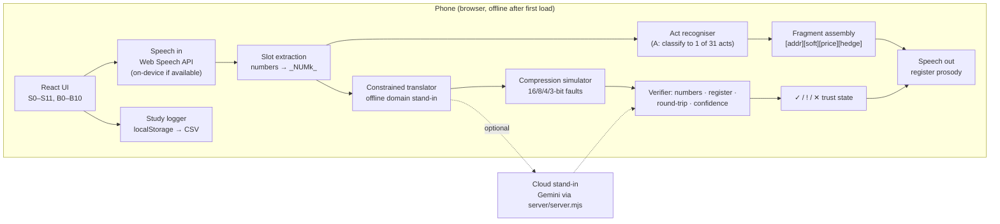

# Bazaar Saathi — High-Fidelity Prototype (CS 435, Assignment 3)

**Offline, politeness-preserving communication for buyers and sellers who share no language at a village market.**

Team: Sahil Gawande · Krudant Randai · Sarthak Patil — IIT Gandhinagar, CS 435 HCI (Dr. Yogesh K. Meena)

This is the working hi-fi version of both designs from our earlier assignments:

| | Solution A — *Pre-written acts* | Solution B — *Checked translation* |
|---|---|---|
| Interaction model | choose → preview → speak | speak → verify → speak |
| What the buyer can say | 31 acts in 10 families (+ fragment assembly) | anything in the market domain (open range with the cloud stand-in) |
| How politeness is kept | native-authored wording per register | register forced in generation, then **checked** |
| Safety net | private preview, "Did you mean?", keypad for numbers | 4-check verifier → ✓ Verified / ! Unchecked / ✕ Blocked |
| Pack (from the proposal) | ~118 MB | ~260 MB |

Both share: offline operation, numbers that never pass through the language path, a three-level politeness switch that is always visible, private preview before anything is said, a seller screen that needs no install, replies that arrive four ways (audio, text, icon, digits), slow replay, repair phrases and a turn history.

---

## 1. Run it

Requirements: Node 18+ and Chrome (desktop or Android). Speech input uses the browser's Web Speech API (best in Chrome); everything also works by tapping and typing.

```bash
npm install
npm run dev            # http://localhost:5173  (add the printed Network URL on a phone on the same Wi-Fi)
npm test               # 14 engine tests: number lifting, act recogniser, verifier, register classifier
npm run build          # static, offline-capable build in ./dist
```

**Offline check (for the demo):** open the built app once (`npm run build && npm run preview`), then switch the laptop/phone to airplane mode and reload — the service worker serves the whole app, phrases, recogniser and verifier from the cache. The badge in the top bar shows `Offline · 0 network calls`.

**Optional cloud stand-in (Solution B open-range translation with Gemini):**

```bash
npm run build
GEMINI_API_KEY=your_key npm run serve     # http://localhost:8787 (key stays on the server)
```

Then Settings → *Solution B translator* → **Cloud stand-in**. (Alternatively choose *Direct (key)* and paste a key; it is stored only in that browser.) The top bar turns amber (`Cloud stand-in ON · uses network`) because this breaks the offline promise; it exists to show what the on-device NMT would do. Its output still passes the **on-phone** verifier.

**Deploy:** push to GitHub and enable Pages → the included workflow (`.github/workflows/pages.yml`) publishes `dist/`. A phone can then open the URL once and keep using it offline.

## 2. Demo script (5–7 min)

1. **Launch** → A · Pre-written acts → Marathi ↔ Hindi, Respectful → Continue. *(S0, S1)*
2. Price & bargain → Counter-offer → type **40** → Next. The private preview shows the **fragment chips** `[address][softener][price][hedge]`, each labelled with its register. Switch to Familiar and back — the wording changes. **Speak aloud.** *(S2→S3a→S4→S7)*
3. The phone "turns" to the seller (screen in **Hindi**): he taps **+** to 50 → Send. Buyer gets the reply four ways; **Replay slowly** (0.7×). *(S8, S9, S9s)*
4. 🎤 Speak → *TEST: noisy stall* → **Did you mean?** → pick. Then Next with no number → **"Enter a number first"** (red outline + buzz). *(S5, S6, S4e)*
5. Seller *long story* → **"Couldn't understand the seller · Number heard: none"** → Show the number on screen → Accept → **Deal**: big total. *(S9b, S10)*
6. Back → B · Checked translation → 🎤 say *"हे कांदे थोडे जुने दिसतात, मी दोन किलोसाठी चाळीस रुपये देईन"* (or tap the TEST sentence). Watch **B4**: numbers lifted to `_NUM1_ _NUM2_`, four checks run → **✓ Verified** with back-translation. *(B3, B4, B5)*
7. Facilitator panel → *Politeness fails* → say it again → **! Unchecked: "it sounds Familiar, not Respectful"** → Speak anyway → **second tap** guard. *(B5u, B5c)*
8. *Number lost* → **✕ Blocked**, the faulty sentence is struck through → **Send the number only**. *(B5x, BK)*
9. History shows each turn with its trust state. Study mode → Results shows the metrics dashboard. *(B10)*

## 3. What is implemented (traceability to A1/A2)

| Need (A2 Table 1) | Where it lives in the prototype |
|---|---|
| **N1** Keep politeness | Politeness switch on every home/preview/result screen (`RegisterSwitch`); native-authored triples per register (`src/data/acts.ts`); counter-offers assembled from register-labelled fragments with **firmer pools on successive offers and no repeated fragment** (A1 §7.3, `buildPhrase`); B: register token + **register classifier** check (`src/engine/register.ts`); prosody per register (respectful slower/flatter, familiar quicker; `services/speech.ts`). |
| **N2** No internet | Service worker caches everything; no login; recogniser, translator stand-in and verifier are local TypeScript; network-call counter; cloud stand-in clearly flagged. |
| **N3** Users who may not read | Picture grid as home; every act has an icon; replies come as audio + text + icon + big digits; trust states have symbol + word + tone + vibration pattern (`services/feedback.ts`). |
| **N4** Safe numbers | Numbers lifted out **before** translation into `_NUMk_` placeholders (Devanagari/Gujarati/Bengali digits, number words in 5 languages, `src/engine/numbers.ts`); typed via keypad; empty → S4e; unheard → S4n; B blocks any sentence whose placeholders are lost or rewritten. |
| **N5** Both people act | Seller screen in **his** language, ±5/±1, Send, Agree, or speak his answer (recognised in his language); flip-to-seller transition. |
| **N6** Recover from slips | Private preview + "hear it myself first"; Did you mean? (top-3); slow replay 0.7×; repair acts (speak slowly / say it shorter / show the number); B5c second-tap guard; B5x four ways out; history replay. |

Screens → code: S0 `Launch` · S1/B1 `Setup` · S2 `AHome` · S3a/b `AActs` · S4/S4e/S4n/BK `AKeypad` · S5/B3 `Listen` · S6 `ADym` · S7/S7b/B8 `Preview` · S8/B6 `Seller` · S9/S9s/B7/B7s `Reply` · S9b/B7x `NotUnderstood` · S10/B9 `Deal` · S11/B10 `History` · B2 `BHome` · B4 `BCheck` · B5/B5u/B5x `BResult` · B5c `BConfirm`.

## 4. Architecture



```
src/
  data/acts.ts            31 acts × 5 languages × 3 registers, fragment frames, seller phrases
  engine/numbers.ts       slot extraction (digits in 4 scripts, number words, units)
  engine/lexicon.ts       market-domain lexicon (Devanagari, Gujarati, Bengali, Latin, romanised)
  engine/parser.ts        frame parser, Solution A act classifier, seller reader
  engine/translator.ts    Solution B offline translator stand-in (register-forced clause generation)
  engine/register.ts      register classifier + register-drift model
  engine/compression.ts   fault injection by precision (the risk the verifier exists for)
  engine/verifier.ts      4 checks + trust contract
  engine/cloud.ts         optional Gemini stand-in (masked input, JSON output)
  engine/pipeline.ts      B end to end
  services/speech.ts      ASR/TTS wrappers, register prosody
  services/feedback.ts    tones + vibration per state
  services/study.ts       tasks, SUS/SEQ, decision rules, CSV export
  screens/*.tsx           all screens + facilitator panel
server/server.mjs         static server + Gemini proxy (no dependencies)
tests/*.test.ts           vitest
docs/                     conceptual model, compromises, evaluation protocol
```

## 5. Usability study mode

Launch → *Usability study (facilitator)*. On a laptop the **facilitator panel** sits beside the phone; on a phone it opens from the 🧪 button. It runs the pilot planned in A2 §9:

- consent screen (voluntary, can stop, no sensitive data, no audio recorded) and a random participant code; counterbalanced order (odd A→B, even B→A);
- the task sheets of A2 Tables 11–12 (A-T1…A-T5, B-T1…B-T4), each with its Wizard-of-Oz preset armed automatically;
- automatic logging per task: time, taps, back-presses, slips, recoveries, screens visited, goal event, B5c dwell time;
- Single Ease Question after each task; SUS + comfort after each prototype; trust-symbol comprehension for B; preference and seller questions at the end;
- **Results** screen with per-prototype and per-task summaries and the three **decision rules** from A2 §9.3 evaluated on the data;
- export `tasks.csv`, `questionnaires.csv`, `participants.csv`, `study_raw.json` → put them in `Evaluation_Data/`.

See `docs/EVALUATION_PROTOCOL.md` for the full protocol, consent text and risk/mitigation table.

## 6. Honest limits

- Wording in Marathi, Gujarati and Bangla was written for the prototype and **must be checked by native speakers** before field use.
- The on-phone translator is a **domain-restricted stand-in** for a distilled NMT model: it composes authored clauses for the market acts it recognises. Off-domain speech is (correctly) Blocked. The cloud stand-in shows open range but needs a network.
- Browser speech recognition is on-device only where Chrome supports it for that language; otherwise the browser's recogniser may use the network (shown on the listening screen). Typing and tapping always work offline.
- Voices depend on the phone's installed TTS voices; when one is missing, text, icons and digits still carry the message.
- Pack sizes and latencies on the setup screen are the proposal's targets, not measurements of this web build.

More in `docs/COMPROMISES.md`.
